  <picture>
    <source media="(prefers-color-scheme: dark)" srcset="https://raw.githubusercontent.com/uryryury/uryryury/main/dark_mode.svg">
    <source media="(prefers-color-scheme: light)" srcset="https://raw.githubusercontent.com/uryryury/uryryury/main/light_mode.svg">
    
  </picture>

  <strong>Muhammad Surya Kusuma</strong> · Physics (Data Science) @ <strong>Institut Teknologi Bandung</strong> (expected Oct 2027) 
  <em>I build forecasting and ML systems, and I check whether they actually work before anyone relies on them.</em>

---

### Selected Work

| Project | Focus | Key Result |
|---|---|---|
| **Cirata Flood Early-Warning System** *(PT PLN Nusantara Power)* | `Time Series` `XGBoost` `FastAPI` `Docker` | Audited 1,358 official spreadsheets vs. telemetry; built 15 inflow models (5 rivers × 3 steps) behind a FastAPI + React/TS dashboard |
| **Asteroid Hazard: Data-Leakage Audit** *(repo publishing Dec 2026)* | `Python` `scikit-learn` `Physics Features` | Found that a two-variable rule reproduced 126,130 of 126,131 labels. Against an orbit-class baseline, a feature based on orbital node distance cut false positives from 48 to 9 at the same recall (30 of 31). The project has 60 tests |
| **IDX Liquidity Forecasting: Null Result** | `Market Data` `Baselines` `Hypothesis Testing` | Built 33,213 checksum-verified stock-months (2023–2025); tested RF & SVM month-by-month vs. persistence (`p = 0.39`) and reported the null |
| **White-Car Traffic Counter** | `YOLOv8` `OpenCV` `HSV/LAB` `CLAHE` | Tracking + line-crossing counter evaluated honestly against manual counts (`+11.6%` day, `-28.4%` night) |
| **Clark-Y Hydrofoil Cavitation** *(Thesis, in progress)* | `OpenFOAM` `C++` `2D URANS` | Simulating sheet & cloud cavitation with a custom turbulence-model modification tested against published experiments |
| **EUREKA! ITB Mail Automation** | `Python` `Google Drive / Docs / Gmail APIs` | Replaced a timing-out Apps Script with a restart-safe Python pipeline generating & sending 500 personalized PDFs/day (~1,000 schools) |

---

### Toolkit

| Area | Tools & Methods |
|---|---|
| **Data & ML** | `Python` · `pandas` · `NumPy` · `scikit-learn` · `XGBoost` · `OpenCV` · `YOLOv8` |
| **Statistics & Validation** | Time-series forecasting · leakage audits · hypothesis testing · bootstrap CIs · baseline checks |
| **Systems & Simulation** | `FastAPI` · `Docker` · `Git` · `Linux (WSL)` · `C++ (OpenFOAM)` · `SQL` · `Google APIs` |

---

### Connect

* **LinkedIn:** [linkedin.com/in/msuryakusuma](https://www.linkedin.com/in/msuryakusuma)
* **Location:** Bandung, Indonesia · Open to remote Data Science, Data Analytics & Quantitative roles
