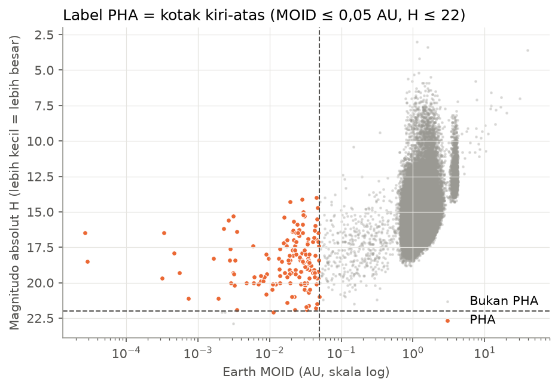

# Data science and quantitative research

Time-series forecasting, model evaluation, and scientific computing.

## Asteroid hazard classification

**A two-variable rule reproduced 126,130 of 126,131 labels.** That explained why a model given those same inputs looked nearly perfect.

With the label-defining inputs removed, a feature derived from orbital geometry reduced false positives from **48 to 9** versus an orbit-class baseline. Both approaches flagged **30 of the 31** hazardous asteroids in the test split. [NASA's hazard classification rule](https://cneos.jpl.nasa.gov/glossary/PHA.html)

## Indonesian stock market liquidity

Built a dataset of **33,213 stock-months** and compared two machine learning models with a persistence baseline over 12 evaluation months. Neither model beat the baseline significantly.

## Current research

**ETH perpetual futures.** Testing whether trade flow predicts 30-minute liquidity droughts beyond simple baselines. The test period has been fixed in the preregistration.
